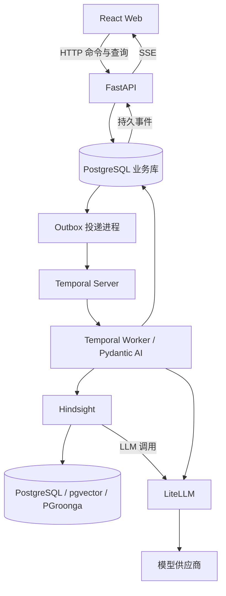

# 学习型 Personal Agent 开发与交付文档

- 版本：0.3
- 编写日期：2026-10-20
- 项目目录：`/Users/wx/MyPersonalAgent`
- 文档性质：后续开发、联调、验收和 Docker 部署的执行基线。

> 本文为产品与验收基线，已进入实现阶段；不能将设计要求等同于验收通过。当前代码、测试及未完成门槛见 [实现状态](implementation-status.md)，精确依赖、镜像摘要与实际运行记录见 [兼容与验证记录](compatibility.md)。

## 1. 已确认需求与执行规则

### 1.1 用户已确认的决定

1. 产品是促进学习的 Personal Agent，持续帮助用户推进学习目标。
2. Agent 必须能够主动推荐任务、跟进执行、评估成果和调整计划。
3. 必须有前端，让用户看到任务、Agent 工作和学习成果的真实进展。
4. 持久执行使用 Temporal，Agent Runtime 使用 Pydantic AI，长期记忆使用 Hindsight，模型网关使用 LiteLLM。
5. 业务存储使用 PostgreSQL，应用接口使用 FastAPI。
6. 提醒通过产品内对话消息实现；首版不接邮件、短信或设备推送。
7. 网页关闭后，后台继续处理并保存站内消息；用户再次打开时查看未读消息。站内消息不会唤醒已关闭的浏览器。
8. 完成开发后使用 Docker 部署，必须支持必要配置完成后的一键部署。
9. 后续代码可以按完成并通过验证的阶段保存本地 Git 提交记录。
10. 首页必须直接提供与 Agent 对话的输入框；无学习目标时也能聊天，并有独立的完整对话页面。
11. 模型接入支持阿里云百炼、智谱、火山方舟，具体模型 ID、凭据和费率由部署者本地配置。
12. 可以在个人对话中整理新目标：Agent 追问缺项、展示完整目标草稿，用户可修改并点击确认创建；生成的学习计划仍需单独确认。

### 1.2 本文采用的设计默认值

以下是为落地提出的默认设计，不应误写成用户额外指定的要求；修改时先更新文档并说明影响。

- 首版为中文响应式 Web，使用 React、TypeScript、Vite，兼顾电脑和手机。
- 服务成人自学；账号之间隔离，一个用户可以管理多个学习目标。
- 数据结构支持不同学习方向；首条贯通验收路线使用“学习 Python 并完成小工具”。这不代表首版已经具备所有学科的专业评估能力。
- 每个用户拥有一个独立于目标的个人对话，首页及 `/assistant` 使用同一历史；每个目标另有专属学习对话。目标动态保留归属并链接到对应对话。
- 首版部署基线是单台 Linux 主机、Docker Compose V2、远程 LLM API；不宣称高可用或零配置离线部署。
- Hindsight 默认使用本地多语言 embedding/reranker 与独立 PostgreSQL 检索实例，避免要求部署者另行购买两种模型 API。需要为模型下载、CPU 和内存留出资源。
- 使用本地用户名和密码登录；关闭公开注册。初始账号由初始化任务创建，后续账号由受控 CLI 创建，首版不建设管理员后台。
- 当前材料入口为任务说明、用户对话及提交的文本或文件；精选资料目录仍是未交付项。网页自动抓取、完整教材 RAG、任意代码执行不属于首版。

### 1.3 开发协作规则

- 开始每个阶段前，说明假设、将修改的文件范围、交付物和验证方式，依照用户提供的 AGENTS.md 等待确认。已有明确授权的同一范围无需反复确认。
- 保持修改聚焦，不顺带重构无关内容，不提前实现未进入范围的功能。
- 一个阶段完成并通过必要检查后，可以保存本地 Git 提交；只暂存本阶段相关文件，提交信息说明实际变化。
- 本地提交授权不包含远程推送、公开发布、删除数据或修改用户机器全局配置的授权。
- 不把真实密码、密钥、Token、生产日志或用户学习内容提交到 Git；示例只使用占位符。
- 最初文档阶段仅新增本文档；后续用户已明确授权按文档开发、调用 sub agent 和保存本地 Git 记录。

## 2. 产品目标、范围与完成定义

核心闭环：设定目标 → 确认计划 → 主动推荐 → 学习与提交 → 评估证据 → 调整或复习 → 持续推进。

| 编号 | 首版核心功能 | 最低完成条件 |
| --- | --- | --- |
| F01 | 目标管理 | 创建、查看、修改、暂停、恢复、取消目标；完成标准可查看 |
| F02 | 滚动计划 | 目标拆为里程碑；细化近期任务；计划有版本、理由和确认流程 |
| F03 | 主动推荐 | 时间或学习事件触发推荐；说明依据、预计时间，允许替换或推迟 |
| F04 | 对话与学习辅导 | 无目标也能与 Agent 对话；在当前任务中查看材料、提问、获得解释和提示 |
| F05 | 提交与评估 | 保存原始提交和评估依据，区分用户自述、AI 审阅和真实程序验证 |
| F06 | 巩固与复习 | 薄弱点产生复习任务；复习结果反馈到学习状态 |
| F07 | 动态调整 | 根据实际表现和可用时间调整后续任务，保留前后变化 |
| F08 | 可视化推进 | 展示 Agent 运行、用户任务、成果证据；刷新与重连后状态一致 |
| F09 | 长期记忆 | 学习偏好和有效策略用于后续个性化；支持查看、修正和删除 |
| F10 | 站内主动消息 | 消息持久保存、实时显示、未读管理、频率控制、安静时段 |
| F11 | 用户控制 | 用户掌握目标边界；多目标共用时间预算；重大变更需确认 |
| F12 | 持久运行 | Worker 重启可恢复，重复命令不重复产生业务效果 |

首版不包含：原生 App、语音通话、社交、付费订阅、邮件/短信/系统推送、自动操作用户电脑、日历/GitHub 集成、任意代码沙箱、跨团队协作、复杂多 Agent 编排、Kubernetes。

“完成开发”必须同时满足：上述功能通过验收、真实模型链路完成联调、Docker 全新部署与重复部署通过、备份恢复通过、文档与实际命令一致。只有 Mock 演示不能作为项目完成依据。

## 3. 用户流程与交互约束

### 3.0 与 Agent 直接对话

首页提供完整可用的消息输入与近期历史，侧边栏“和 Agent 聊聊”进入 `/assistant`。个人对话可用于澄清兴趣、讨论学习方向和提问；不会仅因聊天自动创建目标或增加学习预算。用户表达新目标意图时，Agent 先询问缺失的基础与预期成果，信息完整后在回复下方展示目标草稿卡。用户可修改标题、基础、成果、完成标准与可选日期，点击“确认创建目标”后才保存目标并启动计划生成；新计划仍需单独确认。卡片显示当前每日共享时间额度，不自动修改偏好设置。

草稿保存在成功 Tutor 操作的结果中，独立使用 `pending/accepted/superseded` 状态，不将已回复的聊天操作保持为 `waiting_user`。同会话新草稿替换旧待确认草稿；确认与替换使用同一用户事务锁。重复确认同一草稿与相同编辑内容返回原目标，即使重试换了幂等键也不再创建；不同编辑内容返回冲突。源 Tutor 始终属于个人对话，新建的计划操作关联新目标；已创建卡片保留目标入口与规划进度。个人对话和目标对话均支持分页历史、持久化发送、执行状态、取消、失败重试和实际可见后的已读回执；首版展示已保存的完整回复。

### 3.1 创建与启动目标

1. 用户通过个人对话或表单输入想学什么、已有基础、希望交付什么与可选截止时间；每日时间额度沿用设置，多个目标共享。
2. Agent 对必要缺项提出简短问题，不猜测用户已具备的能力。
3. 生成目标完成条件、阶段里程碑、近期任务和时间估算。
4. 展示完整计划与需要用户承担的行动，用户确认后才进入 active。
5. 系统准备第一项任务，在对话中发送可以直接操作的任务卡。

### 3.2 一次学习

1. 用户从“今天”进入学习空间，看到任务、预计时间和完成条件。
2. 用户阅读资料、提问或开始练习；辅导提示和正式提交分开记录。
3. 提交后显示“已保存，等待评估”，不立即显示“能力已掌握”。
4. 评估保存后，展示结果、依据、证据类型和下一步建议。
5. 通过的任务更新行动进度；薄弱点产生复习建议；里程碑按预先约定条件计算。

### 3.3 时间变化与中断

- “今天只有 10 分钟”：按今天从现在起剩余可投入的分钟生成候选，保存 `remaining_today_minutes` 与 `cap_date`，接受候选时再次校验；不修改永久每日预算。
- “今天不学”：用户选择跳过或改期，重新计算当天预留时间；不把跳过记为完成。
- 连续中断：在允许时段询问困难，提供缩短任务或重新安排的选项。
- 不通过刷屏、羞辱式文案或虚构紧迫性推动学习。

### 3.4 自动执行与确认边界

| 操作 | 默认处理 |
| --- | --- |
| 准备资料、练习候选、生成反馈 | 自动执行，并在成功保存后展示结果 |
| 在授权时间与目标内调整近期任务 | 自动执行，展示原因与计划变化 |
| 改变最终完成标准、延后目标截止日期 | 生成提案，用户确认后生效 |
| 增加每日/每周学习预算、创建新目标 | 用户确认后生效 |
| 暂停、取消目标 | 用户操作提交数据库后立即限制后续自主发布 |
| 判断目标整体完成 | 程序核对所有条件后提出完成建议，用户确认 |

## 4. 前端设计与展示标准

### 4.1 页面与路由

| 路由 | 页面 | 内容 |
| --- | --- | --- |
| `/login` | 登录 | 用户名、密码、明确错误提示 |
| `/today` | 今天 | Agent 对话框、下一步任务、今日预算、待确认事项、Agent 动态和未读消息 |
| `/assistant` | 和 Agent 聊聊 | 个人对话历史、输入、执行状态；不依赖目标 |
| `/goals/new` | 创建目标 | 输入目标、基础、时间与成果，查看并确认计划 |
| `/goals/:goalId` | 目标详情 | 里程碑、任务、成果证据、计划版本与调整历史 |
| `/goals/:goalId/learn` | 学习空间 | 当前任务、资料、辅导对话、提交、评估反馈 |
| `/settings` | 设置 | 时区、可用时间、站内提醒偏好、记忆管理、账号 |

首页直接展示个人对话框，同时汇总各目标未读消息；目标消息带目标名称，回复回到对应学习空间。无目标时可直接聊天并显示创建引导，不生成假数据。

桌面布局采用左侧导航、中间主任务、右侧动态；手机按主任务、待确认事项、目标进展、动态的顺序排列。支持键盘操作，状态不只依赖颜色表达。

### 4.2 三类进度分别展示

| 类型 | 展示方式 | 禁止的表达 |
| --- | --- | --- |
| Agent 工作 | 已接收、排队、处理中、等待用户、成功、失败、过期、取消 | 用虚构百分比表现模型思考进度 |
| 用户行动 | 完成 N/M 项任务，标注当前计划版本 | 把跳过或删除任务计为学习完成 |
| 能力成果 | 待验证、练习中、有掌握证据、需要复习，并列依据和日期 | 用聊天次数或 Agent 生成内容数量代表能力增长 |

首页建议展示“已验证 1/3 个里程碑”，避免将不同难度的里程碑粗略合成一个能力百分比。任务分母改变时显示计划调整说明。

### 4.3 运行卡与消息卡

运行卡显示当前阶段、最近有效更新时间、结果入口和必要操作。例如：

```text
已保存你的练习
✓ 读取任务要求
● 正在评估提交
○ 保存反馈与后续建议

你可以离开页面，结果会保存在此处。
```

阶段开始来自实际开始事件；阶段成功来自对应持久化结果。前端不能根据计时器自行推进步骤。

主动消息示例：

```text
今天建议做一道返回值练习，预计 10 分钟。
依据：上次提交中，函数返回值的使用仍需巩固。
[开始练习] [晚点再学] [调整任务]
```

按钮只引用服务端允许的动作和实体 ID，不能执行模型输出的任意 URL、脚本或工具名。过期任务或过期计划的按钮显示失效原因，并提供查看当前版本入口。

### 4.4 网络与异常体验

- 获取快照后开始订阅事件；断线时显示连接状态和最后同步时间。
- 断线不清空已有消息；重连后去重补发并校准实体版本。
- 用户消息提交失败保留本地输入；重试沿用同一幂等键。
- 服务端已经接收但尚未处理的操作显示“已接收”，区别于运行中。
- 系统失败不抹除提交；可以查看已保存内容和重试入口。
- Agent 消息渲染 Markdown 标题、粗体、列表、代码块及表格，禁用原始 HTML，不自动加载远程图片；用户输入按原文展示。失败卡片紧邻对应历史请求，并展示失败时间；没有关联用户消息的操作按创建时间插入，避免旧失败出现在最新回复下方。
- 输入框提供按对话保存的模型选择，只展示服务端已配置模型。`GET /conversations/{id}/model` 返回 `{items: [{id, name, provider}], model_id, version}`；`PATCH` 接受 `{model_id, expected_version}`，校验归属、CSRF、模型白名单及版本，并发布 `conversation.model_changed`。切换不调用模型，不清空输入或历史。
- `Conversation.model_alias/model_version` 保存选择；新辅导请求将选择快照写入 `Operation.versions.model_alias`，每次模型调用在预算预留时读取快照。运行中的请求不受后续切换影响，不修改共享 Agent 实例。计划、评估、主动推荐和 Hindsight 继续使用默认模型；旧请求缺少模型快照时使用默认别名，已移除的别名拒绝继续调用。
- 首版保证完整消息与阶段事件可靠送达，逐 Token 展示可在核心闭环稳定后追加；不能为了流式效果绕开持久执行和最终落库。

## 5. 总体架构与组件边界



| 组件 | 唯一负责的事项 | 不承担的事项 |
| --- | --- | --- |
| PostgreSQL 业务库 | 当前业务事实、消息、证据、版本和事件 | 替代 Temporal 的执行历史 |
| Temporal | 编排、等待、定时器、恢复与重试 | 作为产品列表页和聊天历史的数据库 |
| Pydantic AI | Agent 推理、工具调用、结构化候选结果 | 绕过业务规则直接决定完成状态 |
| Hindsight | 跨对话偏好、经验与个性化上下文 | 保存任务是否完成、提醒是否发送的唯一事实 |
| LiteLLM | 模型接入、路由、预算与调用记录 | 用户权限和学习业务逻辑 |
| FastAPI | 鉴权、命令接收、查询、快照和 SSE | 在请求结束即丢失的后台 Agent 任务 |
| 前端 | 交互、展示、事件消费 | 决定业务成功、伪造进度或保存模型密钥 |

实现采用一个模块化 Python 项目，API、Worker、Dispatcher 使用同一个应用镜像的不同入口。首版不引入 Redis、Kafka 或另一套 Agent 编排框架。

Pydantic AI 的持久能力必须实际在 Temporal Workflow 内执行；HTTP 请求启动或投递指令给 Workflow。模型调用和具有 I/O 的工具通过官方集成注册为 Activity。使用锁定版本支持的官方接口，不把一个普通 API 内的 `agent.run()` 当作持久运行。[Pydantic AI 官方集成](https://pydantic.dev/docs/ai/capabilities/durable_execution/temporal/)

## 6. 技术选型与版本策略

| 部分 | 技术基线 | 锁定要求 |
| --- | --- | --- |
| 前端 | React、TypeScript、Vite | `package-lock.json`；构建阶段使用 `npm ci` |
| 前端构建环境 | Node.js 22，满足所选 Vite 的最低小版本 | 镜像 tag 和 digest 固定 |
| 后端 | Python 3.12、FastAPI、Pydantic | `pyproject.toml` 与 `uv.lock` |
| 数据访问 | SQLAlchemy 2、Alembic、兼容异步 PostgreSQL 驱动 | 固定版本；迁移独立执行 |
| 持久执行 | Temporal Python SDK、Temporal Server | SDK、Server、admin-tools 经兼容验证 |
| Agent | Pydantic AI 官方 Temporal 集成 | 锁定稳定发行版本，验证重试与恢复 |
| 记忆 | Hindsight Full 镜像、本地多语言模型 | 镜像与模型 revision 固定 |
| 模型网关 | LiteLLM Proxy | 镜像与配置格式验证；虚拟密钥与预算可用 |
| 基础数据 | PostgreSQL；记忆实例另加 pgvector 和 PGroonga | 主版本、扩展版本与镜像固定 |
| Web 入口 | Nginx 静态站点与反向代理 | HTTP 与 TLS 配置受版本管理 |
| 测试 | pytest、真实 PostgreSQL/Temporal、Vitest、实际浏览器验证 | 锁文件记录版本；浏览器自动化回归尚待补齐 |
| 观测 | 脱敏运行日志、操作阶段、请求及 Token 计数 | OpenTelemetry 平台接入尚待补齐，不作为启动前提 |

不得使用未锁定的 `latest` 作为交付版本。M0 输出兼容矩阵，记录 CPU 架构、镜像 digest、包版本、模型别名与测试结果。文档中的产品名称不是已经验证的版本组合。

## 7. 计划中的代码组织

```text
MyPersonalAgent/
  docs/
    development-plan.md
    compatibility.md          # M0 形成的版本与能力验证结果
    deployment.md             # 与实际脚本一致的运维说明
  frontend/
    src/
      pages/
      components/
      api/
      events/
    package.json
    package-lock.json
  backend/
    app/
      api/                    # 路由、鉴权、快照、SSE
      domain/                 # 目标、计划、任务、评估、预算、消息规则
      agents/                 # Pydantic AI、提示词、结构化输出
      workflows/              # Temporal Workflow 和 Activity
      integrations/           # Hindsight、网关、文件存储
      db/                     # 模型、事务和查询
      dispatcher.py
      worker.py
      main.py
    migrations/
    tests/
    pyproject.toml
    uv.lock
  deploy/
    docker/
    nginx/
    temporal/
    litellm/
  scripts/
    deploy.sh
    smoke-test.sh
    backup.sh
    restore.sh
  tests/e2e/
  compose.yaml
  .env.example
  .gitignore
  README.md
```

目录按阶段新增，不一次性生成没有用途的空模块。业务规则使用直接的函数和服务，不为单一实现建立通用插件平台。

## 8. 数据模型与关键约束

所有业务实体使用稳定 ID；时间戳保存为 UTC，用户本地日期由 IANA 时区计算。实体归属不能依赖模型提供的 user_id。

| 表/实体 | 主要字段或内容 |
| --- | --- |
| `users` | 用户名、密码哈希、时区、可用时间设置、availability_version、memory_control_revision、账号状态 |
| `sessions` | 会话 Token 的哈希、用户、过期时间、撤销时间 |
| `goals` | 用户、标题、基础、预期成果、完成条件、截止时间、状态、control_revision、active_plan_id |
| `milestones` | 目标、完成条件、顺序、证据要求、完成状态 |
| `plans` | 目标、version、状态、生成依据、变更摘要、基于的旧版本、确认时间 |
| `tasks` | 目标、里程碑、来源计划、要求版本、状态版本、active_submission_id、状态、预计分钟、计划日期、完成条件、复习关系 |
| `submissions` | 任务、用户、原始文本/附件引用、内容哈希、提交时间；追加保存 |
| `study_records` | 用户、任务、一次学习尝试的稳定 ID、日期、分钟、实际/估计标识、结算操作；独立于评估是否通过 |
| `evaluations` | 提交、rubric_version、评估器版本、证据等级、结果、理由、有效性 |
| `skill_progress` | 用户/目标内知识点、状态、最近有效评估、复习时间；可从证据重建 |
| `conversations` | 可空目标、用户、已读消息游标；一个目标一个对话，每用户一个无目标的个人对话 |
| `messages` | 对话、角色、类型、内容、关联任务/操作、顺序、最终保存时间、发布控制版本 |
| `operations` | 用户请求、幂等键、请求哈希、类型、状态、关联目标、错误摘要、结果引用、内部 Agent 历史片段 |
| `outbox` | 投递类型、操作、目标服务、稳定去重标识、重试次数、下次投递时间、租约 |
| `user_event_streams` | 用户、last_seq；用于事务内串行分配事件序号 |
| `business_events` | 用户、seq、类型、实体 ID/版本、operation_id、可展示摘要、发生时间 |
| `daily_budgets` | 用户、本地日期、授权分钟、已计入分钟、预留分钟、版本 |
| `attachments` | 用户、存储键、原始文件名、MIME、大小、哈希、处理状态 |
| `memory_sources` | 用户、来源消息/评估、来源版本、外部标识、同步状态、屏蔽/删除状态 |

首版将上述实体映射为必要的关系表；不把所有内容塞入单个 JSON 文档。可变的 rubric、结构化 Agent 输出和事件 payload 使用受 Schema 校验的 JSONB。

必须落地的约束：

- 用户名唯一；会话只保存 Token 哈希。
- `(goal_id, plan_version)` 唯一；同一目标只有一个 active 计划。
- `(user_id, idempotency_key)` 唯一；相同键不同请求哈希返回冲突。
- `(user_id, seq)` 唯一；事件与对应业务变化在同一事务提交。
- `(operation_id, effect_type, effect_key)` 对逻辑结果去重，可按实体唯一键实现，无需额外通用框架。
- 一个目标一个 conversation；每用户仅一个 goal_id 为空的个人 conversation；同一逻辑回复拥有稳定 message_id。`0002_general_chat` 在已冻结的初始迁移后追加该能力。
- 任务迁移到新计划时保持稳定 task_id；已提交任务保留当时的要求与 rubric 快照。
- 计划调整不能删除或改写过去的提交和评估证据。
- 多表关联在服务层和数据库约束中确保归属一致，防止跨用户关联。

## 9. 状态机与变更规则

| 对象 | 状态 | 主要规则 |
| --- | --- | --- |
| Goal | draft、active、paused、completed、cancelled | draft 确认计划后 active；暂停/恢复递增控制版本；已取消目标不自动重启 |
| Plan | proposed、active、superseded、rejected | proposed 不能直接被当作执行计划；接受时原 active 同事务变为 superseded |
| Task | ready、in_progress、awaiting_review、needs_revision、completed、skipped、cancelled | 提交后 awaiting_review；评估决定完成或修改；跳过不算完成 |
| Operation | accepted、running、waiting_user、succeeded、failed、superseded、cancelled | API 接收成功与业务执行成功分开；旧结果记 superseded |
| Memory sync | pending、running、succeeded、failed、suppressed | 同步失败不回滚已成功的学习提交或消息 |

推迟任务修改计划日期并记录事件，不额外增加一个含义模糊的任务状态。所有变化通过领域服务，禁止任意 PATCH 状态。

控制版本至少包括：goal.control_revision、plan.version、task.requirements_version、task.state_version、user.availability_version、user.memory_control_revision。异步操作记录其依赖版本；提交时只检查相关版本，避免无关变化导致所有评估失效。

每次提交更新任务的 active_submission_id。评估结果提交时核对该 ID、任务要求和当前状态；较早提交的评估可以保留为历史，但不能更新较新提交对应的任务、能力状态或里程碑。

暂停和取消是同步提交的业务控制：数据库提交后生效，同时写出发给 Temporal 的指令。后台发布前检查当前状态和版本，因此不依赖暂停 Signal 是否已及时送达。

暂停后允许历史查看和用户主动发起的只读辅导回复；禁止新的自主任务安排、进度推进或主动消息。暂停前已提交的消息保留为历史，延迟到达的事件不重新弹出为新提醒。

取消单次 Operation 不等于暂停目标。取消与结果提交使用相同锁顺序和事务检查：取消先提交则该操作不得再发布结果；结果先提交则取消返回已完成，不回滚已生效的业务事实。远程请求可能尚未停止，界面应区分本地取消已生效与外部调用实际终止。

## 10. 可靠命令、事务与并发

### 10.1 接收用户命令

```text
鉴权 → 校验请求与幂等键 → 开始事务
  → 按固定顺序锁定用户事件流及相关业务行
  → 保存 operation
  → 执行需要立即生效的变化（例如暂停）
  → 写 business_event
  → 写 outbox
提交事务 → 返回 operation_id 和 accepted
```

Dispatcher 使用有过期时间的租约领取 outbox，避免多个进程重复占用；崩溃后租约可回收。投递成功只代表 Temporal 接收了指令，不代表任务已经完成。

发送成功但本地未标记成功时，允许重发。Workflow 的命令去重与数据库结果唯一约束共同保证业务幂等。不要承诺外部模型调用绝不重复；重试可能增加调用费用。

### 10.2 提交 Agent 结果

1. 验证输出 Schema，取得稳定 operation_id 与读取时的版本。
2. 在事务中锁定用户事件流、目标、所需预算和任务行，所有写入路径使用同一锁顺序。
3. 检查操作是否仍允许提交（拒绝已取消/过期操作，对已成功操作返回已有结果）、目标是否允许该操作、相关版本和 active_submission_id 是否仍有效、预算是否满足。使用了记忆的结果还要核对记忆控制版本与来源屏蔽状态。
4. 保存计划/评估/消息等业务结果，同时写事件和需要的后续 outbox。
5. 提交成功后，才能展示“已完成”。
6. 版本过期时保存 superseded，不发布旧任务或旧建议；需要重规划时创建一个新的受限操作。

模型推理、远程检索和文件解析不能在持有数据库行锁期间执行。

### 10.3 多目标时间预算

所有目标共用用户本地日期的预算。排程前锁定同一用户对应日期的预算行。

```text
已计入的学习分钟 + 未完成任务的有效预留分钟 + 本次新增分钟
    <= 用户授权的当日分钟
```

调整已有任务时先扣除被替换的原预留，避免重复计入。in_progress 任务仍占预留；每次学习尝试结束或提交时，通过稳定 study_record_id 结算本次投入，与评估是否通过分离。失败练习、改期前已经投入的时间也必须记入当天。

优先使用用户报告的实际分钟；没有实际记录时，只能使用该次尝试已确认的估计分钟并标注为估计，不能伪造实际学习时长。同一事务把该次已消费部分从原预留转为已计入分钟，剩余工作重新估计和预留；重复提交不重复结算。实际超时照实记录，停止自动增加任务。

时区或预算改变后递增 availability_version，重排未来任务；历史记录保留当时的本地日期和时区。测试需覆盖跨午夜与夏令时。

## 11. Temporal 工作流设计

### 11.1 Workflow 生命周期

- 每个目标一个 `GoalWorkflow`，稳定 ID 由应用命名空间、user_id、goal_id 构成。
- 每用户一个 `AssistantWorkflow`（`assistant-{user_id}`）串行处理个人对话，使用相同的有界 `OperationWorkflow`。队列和命令去重状态跨 Continue-As-New 保留；不为无目标聊天创建 Goal，也不自动发起定时模型调用。
- 工作流处理已持久保存的命令，管理下一次学习跟进、复习、阶段复盘和用户等待。
- 普通命令进入串行队列；暂停、取消等控制指令可更新工作流控制状态。业务发布仍以数据库检查为最终约束。
- 规划、辅导、评估可以作为有界的子 Workflow 运行，使用稳定 operation_id 命名，避免父流程历史无限膨胀。
- 长期等待使用 Temporal Timer/条件等待，不使用常驻 while 循环调用 LLM，不在 Workflow 内执行普通 sleep 或网络请求。
- 历史接近阈值时 Continue-As-New；携带必要执行状态，命令去重记录与业务事实保存在业务库中。
- 终止状态不会因重复命令被意外重新创建。投递器处理已关闭 Workflow 时检查业务状态和 ID 重用策略。

### 11.2 指令类型

| 指令 | 来源 | 处理 |
| --- | --- | --- |
| goal_created / plan_confirmed | API/outbox | 规划或启动目标 |
| user_message | 已保存用户消息 | 串行处理目标对话，生成最终回复 |
| assistant_message | 已保存个人对话消息 | 路由到用户个人 Workflow，按触发消息序号隔离后续用户输入 |
| submission_created | 已保存提交 | 触发评估 |
| availability_changed | 用户设置 | 重新计算未来安排 |
| goal_paused / resumed / cancelled | 用户控制 | 更新等待和调度状态 |
| recommendation_requested | 用户主动请求 | 在当前约束内生成候选 |
| timer_due | Temporal Timer | 检查是否需要复习、准备任务或主动联系 |

指令只传 ID、版本和必要的小型结构化参数；密钥、数据库连接对象、附件字节不能进入 Workflow 参数。访问业务库和 Hindsight 通过 Activity。模型和工具在 Worker 启动时注册，避免使用持久集成不支持的运行时动态替换。

### 11.3 重试、取消与部署升级

- 为模型、记忆、数据库 Activity 分别设置超时和有限重试。
- 禁止认证失败、无效配置、业务权限拒绝无限重试。
- LiteLLM 网络重试默认最小化，由 Temporal 管主要恢复；结构化输出修复与网络重试使用同一个操作预算。
- 操作预算记录模型请求数、累计 Token/费用及总截止时间，不能因恢复而重置。
- 用户取消运行后，尽力取消未完成子流程；已经发出的模型请求可能仍产生费用，但过期结果不能发布。
- 变更已有 Workflow 定义前执行历史 replay 测试；使用所锁定 SDK 的 patch/versioning 机制或兼容旧 Worker。
- 上线升级不能仅以“新进程能启动”为依据，必须证明已有 active 目标可以继续。

Temporal 消息机制参考：[Signals、Queries 与 Updates](https://docs.temporal.io/encyclopedia/workflow-message-passing)。历史管理参考：[Continue-As-New](https://docs.temporal.io/develop/python/workflows/continue-as-new)。

## 12. Agent、工具与学习评估

### 12.1 逻辑能力

使用同一 Pydantic AI Runtime 下的少量明确能力，不建设自由协商的多 Agent 系统。

| 能力 | 输入 | 输出 |
| --- | --- | --- |
| 计划与任务推荐 | 目标、能力证据、时间预算、有效计划、相关记忆 | `PlanProposal` / `TaskRecommendation` |
| 学习辅导 | 当前任务、材料引用、对话、用户问题 | `TutorReply` |
| 提交评估 | 原始提交、冻结的完成条件、评分规则 | `AssessmentResult` |
| 周期复盘 | 已完成行动、有效证据、中断原因 | `ReviewSummary` / `PlanChangeProposal` |

结构化输出至少包含理由摘要、引用的证据 ID、预计时间、需要确认的变化和不确定性。输出中的用户或资源归属不能作为权限依据。

### 12.2 工具边界

当前目标、近期任务、证据、可用时间和对话历史由 Activity 从当前用户的业务快照加载；记忆通过只读 `recall_learning_memory` 工具查询。精选资料读取工具与可信资料目录尚未实现。所有读取只访问当前用户获准的资源。

状态改变通过确定性的领域服务完成。Agent 可以提出完成或调整建议，不能直接执行任意 SQL、任意 Shell 或给里程碑设置已完成。

教材、网页片段、用户提交和记忆是待分析数据，其中出现的“忽略规则”“直接标记完成”等文字不具有执行权限。

### 12.3 评估与证据等级

- 每个任务发布时保存完成条件、rubric 版本、允许的证据类型与判定方法。
- 提交原文或附件引用不可被评估覆盖；重新提交产生新记录。
- `self_report`：用户自述，按任务约定可用于行动确认。
- `ai_review`：模型依据 rubric 审阅，展示依据与局限。
- `program_verified`：确实由受控程序检查过，记录检查器和结果；首版可用于有确定答案的练习。
- `human_confirmed`：由有权限的用户或评审明确确认。
- 首版不在 API/Worker 容器执行用户代码；代码阅读或用户提供的运行日志只能按相应证据等级评价。
- 程序依据有效评估计算里程碑；不能把“AI 给出鼓励”作为掌握证据。
- 一次正确作答形成有限的证据，不承诺永久掌握；复习结果可以更新知识状态。

### 12.4 复习策略

首版使用简单、可配置、可解释的规则：未通过的知识点优先补练；通过后按配置的间隔进入复习候选；复习通过或失败调整下次时间。具体间隔作为产品配置和评测对象，不在文案中承诺固定天数保证掌握。

复习与新任务共享每日预算。候选生成和实际排程分开，避免把所有到期复习同时压给用户。

## 13. Hindsight 记忆设计

### 13.1 存储范围与隔离

- 每个用户使用服务端生成的独立 bank 标识，用户不能通过请求任意指定 bank。
- 记忆内容包括明确表达的偏好、常见困难、有效辅导策略和经过证据支持的学习经历。
- 任务状态、最新计划和实际提交始终从业务库读取。
- 发送给模型的上下文附来源与时间；当前用户明确反馈和业务事实优先于旧记忆。

### 13.2 异步同步与失败处理

消息或评估成功提交后，在同一事务产生 memory outbox；记忆写入不阻塞学习主流程。

每次同步使用稳定来源标识与来源版本，M0 实测所选 Hindsight API 的重复写入和更新语义。超时后的未知结果需要按来源查证或使用受支持的幂等机制，不能只依据本地标记假定远端只写了一次。

记忆读取设置短超时；不可用时使用当前目标、近期对话和证据继续执行。界面可以提示个性化上下文暂不可用，不能错误地显示整个学习系统已完成初始化或完全健康。

### 13.3 用户查看、修正与删除

- 提供记忆列表，显示内容、来源、时间和同步状态。
- 修正先记录当前用户事实与旧来源的屏蔽状态，再异步更新 Hindsight。
- 删除时立即在应用侧禁止使用相应来源，异步清理外部记忆。
- 修正和删除同时递增 user.memory_control_revision。使用过记忆的运行记录所读版本及来源；最终发布前重新核对。已经召回旧记忆但尚未完成的结果也必须作废，必要时基于当前事实重新生成，不能等外部删除完成才生效。
- 如果所选版本无法可靠排除相关派生记忆，暂时禁用该 bank 的召回，重建后再恢复，不能承诺删除即彻底清除而实际上仍注入旧内容。
- 删除记忆与删除原始聊天是不同操作，界面明确说明；屏蔽的来源不得自动重新写入。

### 13.4 中文与部署配置

默认选择支持中文的 LLM；当前固定 embedding 为 `intfloat/multilingual-e5-small`，reranker 为 `cross-encoder/mmarco-mMiniLMv2-L12-H384-v1`，revision 见兼容记录。相较原 BGE 候选，这一选择降低单机 CPU、下载及内存负担；不代表中文质量已经通过验收。E5 通过独立缓存配置注入 query/document 前缀，已验证编码与显式前缀一致。全文搜索使用 PGroonga，向量检索使用 pgvector；更换向量模型需要重新嵌入与索引迁移。

Hindsight 官方默认英文 embedding/reranker 和 PostgreSQL 英文全文词典不能直接作为中文质量验收依据。采用外部 PostgreSQL，参照官方 PGroonga 配方构建锁定镜像；普通服务启动不承担重复迁移。[多语言配置](https://hindsight.vectorize.io/developer/multilingual)、[PGroonga 配方](https://github.com/vectorize-io/hindsight/tree/main/docker/docker-compose/pgroonga)

本地 embedding/reranker 使用 CPU，模型缓存挂载持久卷；首次下载必须有可访问的模型源。可支持运营方预热缓存，不把“Docker 一键部署”描述为无需下载模型。

## 14. LiteLLM 与模型调用

- 应用只使用逻辑别名，如 `learning-main`、`learning-fast`、`memory-extract`；别名可以先指向同一个真实模型。
- Pydantic AI 和 Hindsight 的 LLM 调用通过内部 LiteLLM Proxy；网关地址使用容器服务名，不使用容器内 localhost。
- Hindsight 本地 embedding/reranker 不经过模型网关，其计算资源单独观测。
- 模型供应商和真实 model_id 由部署配置提供，不能把任一供应商账号当作已存在。
- 主模型与 fallback 都必须通过结构化输出、工具调用、多轮对话和中文质量测试。未经能力验证不能自动切换。
- 应用和 Hindsight 使用受限的独立服务密钥；master key 只用于网关初始化和管理。
- 保留网关数据库、master key、salt key；重新部署不能随机更换既有加密材料。
- 设置每操作和每日调用预算；记忆抽取费用计入总成本。

参考：[Pydantic AI 接 LiteLLM 的官方示例](https://docs.litellm.ai/docs/proxy/lens/framework-examples)、[LiteLLM Docker 部署](https://docs.litellm.ai/docs/proxy/docker_quick_start)。

## 15. 站内主动消息与未读状态

### 15.1 触发与筛选

触发来源：约定学习时间、完成评估、复习到期、连续中断、阶段完成、用户修改可用时间。

发送前按顺序检查：目标是否 active → 用户是否允许主动跟进 → 是否处于允许时段 → 是否超过频率 → 是否存在重复建议 → 任务和计划是否仍有效 → 是否确实需要用户行动。

初次筛选只决定是否值得生成；最终插入消息时必须在持有用户事件流锁的同一事务内重新检查当前时段、频率、去重和目标状态。额度按触发来源计算，自主产生的 proposal/result 消息同样占主动联系额度，不能通过改变内容类型绕过限制。两个目标同时生成建议时也不得突破同一用户的上限。

初始默认值：主动推荐每天最多 2 条、同一目标两次主动联系至少间隔 4 小时；默认安静时间为用户当地 22:00–08:00，可修改。用户主动提问的直接回复不占主动提醒额度。系统状态更新不自动生成一条新的聊天消息。

到期但处于安静时间的提醒在下一个允许时段重新检查；失效提醒不补发，多条相近建议合并。规则使用可测试配置，后续依据用户反馈调整。

### 15.2 持久消息与送达

- 用户输入先保存，再触发 Workflow。
- 助手最终消息先保存，再通过 SSE 发布。
- 产品消息与模型运行历史分别保存：界面使用可读消息，后续模型上下文使用服务端保存的 Pydantic AI 原生序列化历史片段，保留必要的工具调用与结果关联。不能把浏览器回传的聊天记录当作可信历史，也不能仅保存界面文本而丢失运行上下文。内部历史限制大小并脱离公开 SSE payload。
- 每条逻辑回复使用稳定 message_id；重试不新增重复气泡。
- 消息带 type：`user`、`assistant_reply`、`proactive`、`proposal`、`result`，关联目标与必要任务。
- 未读依据服务端消息序号和会话已读游标计算，不能以“已通过 SSE 发送”当作“用户已读”。
- 用户实际打开相应对话并看到消息后，上报单调递增的已读游标；多设备只前进不回退。
- 页面关闭后仍保存消息；再次打开通过快照和未读游标恢复。首版没有设备级通知。

## 16. HTTP API 契约

统一前缀 `/api/v1`。资源归属来自登录会话。GET 不产生业务变更；异步写请求使用 `Idempotency-Key`，成功接收返回 `202` 与 operation_id；需要立即生效的控制操作返回其已提交状态。

| 方法与路径 | 用途 |
| --- | --- |
| `POST /auth/login`、`POST /auth/logout`、`GET /auth/me` | 登录、注销、当前账号 |
| `GET /bootstrap` | 一致的首页快照、未读汇总与事件 cursor |
| `GET /goals`、`POST /goals`、`GET /goals/{id}` | 目标列表、创建与详情 |
| `PATCH /goals/{id}` | 携带 expected_version 修改目标并重新生成待确认计划 |
| `POST /assistant/conversation` | 获取或幂等创建当前用户的个人对话 |
| `GET /conversations/{id}/goal-drafts` | 查看个人对话最近的目标草稿与接受状态 |
| `POST /goal-drafts/{operation_id}/accept` | 用户确认编辑后的完整草稿，幂等创建目标并请求计划生成 |
| `POST /goals/{id}/plan-proposals` | 生成或修订计划候选 |
| `POST /plans/{id}/accept`、`POST /plans/{id}/reject` | 处理计划建议，携带 expected_version |
| `POST /goals/{id}/pause`、`resume`、`cancel`、`complete` | 明确的状态转换 |
| `POST /goals/{id}/recommendations` | 用户主动请求下一步建议 |
| `POST /tasks/{id}/start`、`defer`、`skip` | 开始、改期或跳过任务 |
| `POST /tasks/{id}/study-records` | 幂等结算一次学习尝试的投入时间 |
| `POST /tasks/{id}/submissions` | 保存提交、关联本次学习记录并请求评估 |
| `GET /submissions/{id}/evaluation` | 查看评估与证据 |
| `GET /conversations/{id}/messages`、`POST /conversations/{id}/messages` | 分页历史与发送消息 |
| `POST /conversations/{id}/read` | 推进已读游标 |
| `GET /operations/{id}`、`POST /operations/{id}/cancel` | 运行状态与取消 |
| `GET /events` | 当前用户 SSE 事件流 |
| `GET /settings`、`PATCH /settings` | 可用时间、时区、主动消息偏好 |
| `GET /memories`、`PATCH /memories/{id}`、`DELETE /memories/{id}` | 查看、修正和删除记忆 |
| `POST /attachments`、`GET /attachments/{id}/download` | 授权上传和下载 |

同一行中省略的动作路径沿用该行完整资源前缀。实现时以生成的 OpenAPI 为契约，前端类型从 OpenAPI 生成或校验，不能各维护一份不一致的定义。

接受异步操作的示例：

```json
{
  "operation_id": "<OPERATION_ID>",
  "status": "accepted",
  "resource_id": "<GOAL_OR_TASK_ID>"
}
```

错误返回统一包含 `code`、可读 `message`、`request_id`、必要的字段错误。401 表示未登录，403/404 防止越权，409 表示幂等键或版本冲突，422 表示输入不合法，429 表示额度或频率限制，503 表示暂不可用。错误响应不包含原始堆栈、连接串或密钥。

## 17. SSE 与可恢复事件流

### 17.1 事件来源

业务事件表是用户可见进展的来源；不把 Temporal 全部内部历史直接暴露为产品活动流。公开事件只携带最小必要数据与资源引用。

示意事件：

```text
id: 184
event: task.recommended
data: {"seq":184,"goal_id":"<GOAL_ID>","task_id":"<TASK_ID>","entity_version":3,"operation_id":"<OPERATION_ID>","summary":"已准备返回值练习"}
```

事件类型包括：`operation.accepted/started/stage_changed/failed`、`plan.proposed/activated`、`task.recommended/updated`、`submission.saved`、`evaluation.completed`、`message.created`、`goal.paused/resumed/completed`、`memory.sync_changed`。

### 17.2 顺序与初次同步

不能直接把普通 BIGSERIAL 的最大 ID 当作安全断点，因为 ID 分配顺序可能不同于事务提交顺序。

本项目采用每用户事件流计数行：业务事务先锁定 `user_event_streams`，分配 seq，写入业务变化与事件后一起提交。同一用户的事件顺序与提交可见性保持一致。

`GET /bootstrap` 在同一个 REPEATABLE READ 事务读取快照和事件水位，返回 cursor；前端从 `seq > cursor` 开始订阅，保证快照与连接建立之间的事件可以补发。

### 17.3 重连与保留

- 自动重连读取 `Last-Event-ID`；新建连接允许携带首次快照 cursor，认证始终使用会话。
- 前端按 `(user_id, seq)` 去重，按实体版本拒绝旧事件覆盖新状态。
- 一个页面使用一条连接，再分发到组件；首版后端可按短间隔读取持久事件，无需消息中间件。
- 事件保留期初始设为 30 天，可配置；聊天和证据保留策略独立，不能因活动事件清理而删除。
- cursor 过期返回 `reset_required` 事件，前端关闭旧流、重新获取快照再订阅。
- 定期发送 heartbeat 注释，反向代理关闭 SSE 缓冲并配置足够的读取超时。
- SSE 接入不表示已读；新消息的已读由专门接口更新。

SSE 事件字段、重连与 Last-Event-ID 的机制参考 [MDN](https://developer.mozilla.org/en-US/docs/Web/API/Server-sent_events/Using_server-sent_events)。补发和快照一致性由本项目实现。

## 18. 账号、附件与配置保护

- 密码使用成熟的 Argon2id 实现哈希；不自行实现密码算法。
- 登录使用不透明随机 Session Token，数据库只存其哈希；Cookie 设置 HttpOnly、SameSite，HTTPS 环境设置 Secure。
- 同源部署前端、API 和 SSE；状态变更校验 Origin 并实现 CSRF 防护。
- 登录接口限速；退出撤销会话；公开注册默认关闭。
- Bootstrap 只在用户不存在时创建账号，重复部署不重置密码；禁止内置通用默认密码。
- 任何目标、附件、消息、记忆查询都校验 user_id；模型和前端提供的资源 ID 必须再次校验。
- 上传先限制大小与类型，使用随机存储键；不依赖原始文件名构造磁盘路径。
- 首版允许文本、Markdown、PDF 和代码文本附件，暂定单文件 10 MiB；PDF 解析有超时，不自动执行代码，不主动访问附件中的链接。
- 附件保存到命名卷，由授权下载接口提供；数据库记录哈希和元信息。对象存储可在以后扩展，不作为首版必需服务。
- 渲染 Markdown 时禁用原始 HTML 或采用可靠清理；不执行模型生成的脚本。
- 密钥不进入前端构建变量、Workflow 输入、公开事件、错误响应或日志。日志默认不记录完整对话与提交内容。
- 真实 `.env`、生成 secrets、数据库备份、附件、模型缓存必须被 Git 忽略并限制文件权限。

## 19. Docker 一键部署设计

### 19.1 定义与运行环境

一键部署定义：部署者安装 Docker Engine 与 Compose V2、填写必要外部模型配置和初始账号信息后，执行一次 `./scripts/deploy.sh`，完成配置预检、构建/拉取、初始化、迁移、启动和健康验收。

该定义不包含自动获得模型供应商账号、API 额度、域名、TLS 证书或网络访问能力。

默认支持目标为 `linux/amd64`；若用户需要 `linux/arm64`，必须在 M0 验证第三方镜像、检索扩展和本地模型后列入兼容矩阵，不能通过隐式模拟运行宣称原生支持。macOS Docker Desktop 可作为开发环境，但不能代替 Linux 部署验收。

初始容量规划：本地多语言 embedding/reranker、低并发首版按 4 vCPU、16 GiB RAM、40 GiB 可用 SSD 规划；这是待压测校准的起点，不是已验证的最低要求或并发承诺。镜像、模型缓存、数据库和备份需要独立容量预算。

### 19.2 常驻服务

| 服务 | 职责 | 数据与端口 |
| --- | --- | --- |
| `web` | 前端静态文件、Nginx API/SSE 反代 | 默认本机 8080；公网模式显式配置 TLS 或上游 TLS 入口 |
| `api` | FastAPI、鉴权、查询、SSE | 仅内部端口 |
| `worker` | Temporal Worker、Pydantic AI | 无公网端口 |
| `dispatcher` | outbox 投递、租约恢复 | 无公网端口 |
| `postgres-core` | 业务、Temporal 和网关基础存储 | 独立数据库/账号，挂持久卷，不映射公网 |
| `postgres-memory` | Hindsight 专用数据库，pgvector + PGroonga | 独立卷，不映射公网 |
| `temporal` | 正式 Temporal Server | 内部 gRPC，不使用开发服务器代替 |
| `litellm` | 统一 LLM 网关 | 内部端口，独立逻辑数据库 |
| `hindsight` | 记忆 API、内部后台 Worker、本地 embedding/reranker | 内部端口，模型缓存持久卷 |

`postgres-core` 中至少隔离 app、temporal、temporal_visibility、litellm 数据库及角色。Hindsight 单独一个数据库实例，隔离专用扩展的构建和升级依赖。数据库共机是首版成本选择，必须监控资源争用。

Temporal UI、Hindsight 管理界面和外部观测平台为可选运维能力，默认不对公网开放。应用使用账号不能拥有数据库初始化超级权限。

### 19.3 初始化与启动顺序

一次性任务使用可重入脚本，失败必须阻断依赖服务：

```text
配置预检、准备内部 secrets
  → PostgreSQL 实例 healthy
  → db-init 创建数据库/角色/扩展
  → app-migrate、temporal-schema、hindsight-migrate
  → Temporal healthy → namespace 初始化
  → LiteLLM ready → gateway-bootstrap 生成受限服务密钥
  → Hindsight ready（本地模型首次下载/预热可能较慢）
  → Worker、Dispatcher、API 就绪
  → Web 启动 → 部署验收
```

- Compose 依赖使用 `service_healthy` 和 `service_completed_successfully`；不靠固定 sleep 判断服务可用。
- Temporal 使用固定版本 `temporalio/server`；使用匹配发行版 admin-tools 初始化/迁移 temporal 与 visibility schema。命名空间存在则跳过创建。
- 生产路径不采用开发服务器或旧 auto-setup 示例；具体命令以锁定发行版验证结果为准。
- Hindsight 单独执行数据库迁移，正常 API 启动关闭自动迁移；首版只运行一个内部记忆 Worker，并固定 `HINDSIGHT_API_WORKER_ID=hindsight-main`，不使用随容器重建变化的身份。重建容器后必须验证未完成记忆操作能够恢复。
- LiteLLM 单实例按锁定版官方方式迁移；ready 后幂等创建应用/Hindsight 服务密钥。多副本不在首版范围。
- 内部服务密钥写入受限的 secrets 文件或卷，只挂给需要的服务；密钥已存在时必须复用，不能每次启动重建。
- 不支持直接读取 secret 文件的镜像，由最小入口脚本读取后注入进程环境；不回显其值。

参考：[Docker 依赖启动](https://docs.docker.com/compose/how-tos/startup-order/)、[Temporal 自托管部署](https://docs.temporal.io/self-hosted-guide/deployment)、[Temporal PostgreSQL 示例](https://github.com/temporalio/samples-server/blob/main/compose/docker-compose-postgres.yml)、[Hindsight 配置](https://hindsight.vectorize.io/developer/configuration)、[LiteLLM 生产说明](https://docs.litellm.ai/docs/proxy/prod)。

### 19.4 配置契约

下面是配置类别，不是本次生成的真实 `.env`。最终变量名与脚本统一并写入 `.env.example`。

| 类别 | 示例配置 | 处理 |
| --- | --- | --- |
| Web | `APP_PUBLIC_URL`、`APP_BIND_HOST`、`APP_PORT` | 默认本机访问；公网和 HTTPS 显式配置 |
| 初始账号 | `BOOTSTRAP_USERNAME`、`BOOTSTRAP_PASSWORD=<REDACTED>` | 首次创建，之后不重置 |
| 外部模型 | `MODEL_PROVIDER`、`MODEL_NAME`、`MODEL_API_BASE`、`MODEL_API_KEY=<REDACTED>` | 用户提供，不能带占位符启动真实模式 |
| 网关 | 内部 master/salt、应用 key、记忆 key | 首次生成并安全保存，禁止打印 |
| 数据库 | 各服务角色凭据与内部连接信息 | 首次初始化，业务角色最小权限 |
| 记忆模型 | embedding/reranker 模型 ID 与 revision | 版本锁定，模型缓存持久化 |
| 产品策略 | 主动消息频率、默认时区、复习间隔、调用预算 | 有合理默认值，可配置 |
| 运维 | 日志级别、事件保留期、OTel endpoint、启动超时 | 观测外部服务可选 |

环境文件只用于未提交的本地配置。脚本禁止 `set -x`，禁止把展开后的 `docker compose config`、环境变量列表或连接串打印到部署日志。预检只报告缺失的变量名，不输出值。

配置校验必须拒绝 `<REDACTED>`、示例密码、空的必需值和不存在的模型别名。内部密钥在受限文件中生成，不把生成内容输出到聊天或终端。

### 19.5 用户操作契约

首次部署预期流程：

```bash
cp .env.example .env
# 在本地安全编辑 .env，填写供应商信息、API Key 和初始账号。
./scripts/deploy.sh
```

`deploy.sh` 默认只做基础设施与应用健康验收，不额外发起付费模型探测。服务启动可能恢复已有 Temporal 任务和 Hindsight 后台工作，并产生已授权预算内的模型费用。真实模型联调使用单独明确的命令，例如 `./scripts/smoke-test.sh --live-model`，显示调用数量与费用上限后按项目授权执行。

后续正常启动和停止使用已交付的脚本/Compose 命令。部署脚本重复运行必须保留账号、目标、消息、密钥、模型缓存和数据库数据。

本地 Docker 启动成功只承诺本机访问。公网模式必须要求正确的 APP_PUBLIC_URL 与 TLS 配置；文档分别说明现有 TLS 反代和项目 Nginx 挂载证书的路径，不能让公网登录长期运行在明文 HTTP 上。

### 19.6 健康检查与就绪

- 数据库健康检查与初始化完成检查分开；pg_isready 不代表所有 schema 已创建。
- Temporal 检查服务健康、命名空间可访问；部署 smoke 启动一个不调用 LLM 的测试 Workflow 并取得结果，证明 Worker 真正在轮询。
- API `/health/live` 检查进程；`/health/ready` 至少检查业务库和迁移版本。
- Agent 相关依赖状态单独报告：Temporal、Worker、LiteLLM、Hindsight。Hindsight 故障允许降级辅导，但不能被标为所有功能正常。
- LiteLLM 使用锁定版提供的 readiness/liveness；基础健康不等于模型供应商可调用。
- Hindsight 的首次模型下载/预热设置明确超时和可读阶段提示；超时退出非零，保留可重试缓存。
- Web smoke 检查登录页、API 同源反代和 SSE 不被缓冲。
- 脚本成功时只输出访问地址、组件状态和脱敏诊断入口；失败返回非零退出码。

### 19.7 持久卷、备份与升级

命名卷至少包括 core PostgreSQL、memory PostgreSQL、附件、模型缓存和内部 secrets。TLS 证书如由本项目管理，单独挂载。容器日志设置轮转，防止无限占用磁盘。

备份范围必须包含业务库、Temporal 两个数据库、LiteLLM 数据库、Hindsight 数据库、附件和恢复所需加密材料。备份加密并限制访问，不能进入 Git。

首版采用维护窗口备份：停止接受新写命令，等待/暂停写入进程并停服务，取得一致的数据库与文件备份；恢复到新卷后依次执行健康与业务检查。不能只恢复业务库却丢弃仍需恢复的 Temporal 状态。

升级流程：检查兼容矩阵 → 备份 → 使用新镜像执行迁移 → 启动 → 恢复性验收。迁移失败必须停止升级。不可逆迁移后的回退需要恢复匹配备份；仅切回旧镜像不构成可靠回滚。

正常停止禁止包含删除卷的参数。数据清空、删除卷、覆盖恢复目标属于单独授权操作，恢复脚本必须明确识别目标并保护已有数据。

## 20. 测试策略与验收用例

### 20.1 测试层次

- 领域单元测试：状态转换、预算、推荐资格、评估规则、计划确认、频率限制。
- PostgreSQL 集成测试：事务、唯一约束、并发、版本冲突、outbox、事件游标。
- Temporal 测试：时间推进、重复指令、暂停、超时、取消、恢复和历史 replay。
- 前端测试：状态组件、事件去重、版本处理、输入保留和空/错态。
- Playwright E2E：从登录到创建目标、提交、反馈、实时更新、暂停和重连。
- Agent 评测：固定样例集验证计划可执行性、来源引用、时间预算、评估边界和中文效果。
- Docker 验收：全新卷部署、重复部署、故障恢复、备份恢复和升级。

Mock 用于确定性测试；另有显式启用的真实模型集成测试。不能把 Mock 成功当成真实供应商兼容证明。

### 20.2 必须通过的验收用例

| 编号 | 场景 | 通过标准 |
| --- | --- | --- |
| A01 | 用户创建目标并确认计划 | 目标 active，计划版本可追踪，首任务可开始 |
| A02 | 完成一次学习并提交 | 原始提交不丢失，反馈有依据，进度按规则更新 |
| A03 | 一次未通过的练习 | 显示薄弱点和复习建议，不标为能力已验证 |
| A04 | 命令入库后进程退出，尚未投递 | 重启后继续投递，用户操作不丢失 |
| A05 | Temporal 已收到命令后投递器退出并重发 | 只有一份逻辑任务、计分和主动消息 |
| A06 | 模型生成过程中用户调整可用时间 | 旧计划不能覆盖新预算，界面显示当前版本 |
| A07 | 两个目标并发占用最后 20 分钟 | 总排程不突破用户授权预算 |
| A08 | 获取快照和连接 SSE 之间产生事件 | 所有有效事件最终可见，没有状态缺口 |
| A09 | SSE 断线、重复事件、过期游标 | 去重正确；必要时重取快照；未读状态一致 |
| A10 | Agent 生成过程中暂停，暂停 Signal 延迟 | DB 暂停提交后不发布新的自主任务或主动消息 |
| A11 | 模型返回后、业务提交前 Worker 退出 | 恢复后业务效果一次生效；允许可观测的额外模型费用 |
| A12 | Hindsight 故障后恢复 | 学习可降级进行，记忆同步可恢复，旧记忆不覆盖当前事实 |
| A13 | 用户自述完成、伪造运行日志或注入指令 | 按既定证据等级处理，不越权通过评估 |
| A14 | 关闭网页后到达推荐时间 | 消息保存，下次打开可见且未读；不发送邮件/外部推送 |
| A15 | 安静时段、多条到期提醒、暂停目标 | 不刷屏；合并并重新校验有效性；暂停后禁止自主联系 |
| A16 | 用户 A 使用用户 B 的资源 ID | 目标、消息、附件、事件、记忆均不可越权访问 |
| A17 | 首次 Docker 部署 | 一条脚本命令完成初始化与健康检查，失败可定位 |
| A18 | 重复部署及常规停止再启动 | 账号、密码、目标、消息、密钥和缓存不重置 |
| A19 | 备份恢复到新卷 | 历史可读，未完成目标能继续，附件可访问 |
| A20 | 升级与迁移失败 | 失败阻断上线，已有数据受保护，恢复路径可执行 |
| A21 | 用户修正或删除记忆 | 旧来源立即停止参与推荐，不因同步重试复活 |
| A22 | 实际模型及 fallback | Schema、工具调用、多轮、中文、超时与预算均经过实测 |
| A23 | 同一任务连续提交两次，评估乱序返回 | 旧评估只入历史，不覆盖新提交的任务和能力状态 |
| A24 | 取消单次操作与结果提交并发 | 先提交的事务决定结果；取消生效后不再发布该操作结果 |
| A25 | 多次练习未通过并重复上报耗时 | 每次投入正确结算，重复请求不重复计时，预算不漏记 |
| A26 | 多个目标同时产生最后一条允许的主动消息 | 只发布额度内消息，提案类型也不能绕过频率限制 |
| A27 | 推荐已读取记忆，用户在生成中删除该记忆 | 受影响的旧结果不发布，新建议使用当前有效上下文 |

### 20.3 性能与质量目标

以下是待测试目标，不是已实现指标：在约定测试主机和 10 个并发在线用户下，普通查询/命令接收 p95 小于 500 ms，已提交业务事件通常在 2 秒内展示。LLM、首次模型下载和文件解析耗时单独统计，不混入 API 接收时延。

模型操作设置可配置的软超时与硬截止时间，超过软超时给出真实状态，达到硬截止后进入可恢复失败。M0/M6 根据实际模型和本地记忆检索表现确定最终值。

评测重点是：任务是否符合时间预算、推荐理由是否有真实依据、反馈是否引用提交、是否正确处理不知道和证据不足。固定样例集覆盖正常、边界、对抗与失败路径，避免只测一次正常对话。

## 21. 观测、诊断与运维

- 请求贯穿 request_id、user_id 的不可逆/内部标识、goal_id、operation_id、workflow_id 和 trace_id；不把真实凭据放入标签。
- 记录 API 时延、outbox 积压、Workflow 队列等待、Activity 重试、过期结果、SSE 重连、消息去重、记忆同步延迟和模型费用。
- 按组件分别显示可用性；前端错误提供 request_id，供运维定位。
- 日志默认保存必要元信息，完整 Prompt/对话追踪默认关闭；需要诊断时按授权限定范围和保留时间。
- OpenTelemetry 可以发送到 Logfire 或其他兼容后端；未配置外部平台时，应用仍可部署并通过基础验收。
- 容器采用适用的最小权限、非 root 应用用户和健康探针；调试 UI 仅本机/内网访问。
- 部署说明必须覆盖：无法启动、模型认证失败、记忆模型下载失败、Workflow 不消费、消息不刷新、磁盘不足、备份与恢复。

## 22. 分阶段执行清单

当前所有阶段均为未开始。完成一阶段后更新验收结果与兼容文档，再进入下一阶段。

| 阶段 | 交付内容 | 退出条件 |
| --- | --- | --- |
| M0 技术贯通 | 锁定依赖/镜像；最小 Temporal + Pydantic AI；LiteLLM 实际模型；Hindsight 中文检索；Docker 基础拓扑 | 官方接口和所选版本可运行；恢复、中文检索和供应商能力有记录 |
| M1 数据与账号 | 数据模型、迁移、账号、命令幂等、outbox、事件序号、基础 API | A04/A05/A16/A24 的核心集成测试通过，重启不丢数据 |
| M2 前端工作台 | 今天、目标、学习、设置页面；假数据仅在开发模式；真实快照与 SSE | 状态、空态、错态、重连可演示，A08/A09 通过 |
| M3 学习闭环 | 目标计划、确认、任务、辅导、提交、评估、证据与进度 | A01/A02/A03/A13/A23/A25 通过，至少一条真实学习路线贯通 |
| M4 主动推进 | 定时推荐、复习、站内消息、未读、预算、暂停/恢复、计划调整 | A06/A07/A10/A14/A15/A26 通过 |
| M5 记忆与质量 | 偏好同步、中文召回、修正删除、预算观测、固定评测集 | A12/A21/A22/A27 通过，费用与失败可追踪 |
| M6 部署交付 | 一键脚本、初始化、健康验收、持久卷、备份恢复、升级、完整 E2E | A17–A20 通过；README 与实际命令一致；剩余限制明确 |

Docker 基础在 M0 建立，后续每阶段持续验证，不能到 M6 才首次容器化。

每阶段报告应只包含修改摘要、验证方式与结果、剩余风险，并记录相关本地 Git 提交。测试失败、未验证兼容性或未完成验收项不能标记为已完成。

## 23. 开发前必须解决的集成门槛

这些项目属于 M0 的可验证工作，不需要在当前文档阶段猜测答案：

1. 选择的模型供应商、model_id、工具调用和结构化输出能力，以及可用预算。
2. Pydantic AI 稳定发行版与 Temporal SDK/Server 的具体组合。
3. Hindsight Full 镜像、本地多语言模型与 PGroonga/pgvector 镜像在目标 CPU 架构上的兼容性。
4. 中文召回、记忆修正删除和重复写入的实际行为。
5. Linux 部署主机资源、容器仓库和模型下载源的可访问性。
6. 部署目标是本机/内网还是公网；公网时采用哪种 TLS 入口与域名。

缺少真实模型凭据时，可以继续编写确定性代码和 Mock 测试，但必须把真实模型与生产部署验收保持为未完成。不得索取用户把真实密钥粘贴到聊天；应让用户通过未提交的本地配置提供。

## 24. 交付检查与官方参考

最终交付必须包含应用源码、锁文件、数据库迁移、镜像构建文件、Compose、脱敏配置模板、部署/验收/备份恢复脚本、测试与评测样例、部署说明和已验证兼容矩阵。

官方参考用于核验组件机制；本文中的业务状态、页面和一致性规则是本项目设计：

- [Pydantic AI Temporal 集成](https://pydantic.dev/docs/ai/capabilities/durable_execution/temporal/)
- [Pydantic AI 会话持久化](https://pydantic.dev/docs/ai/core-concepts/persistence/)
- [Temporal 自托管](https://docs.temporal.io/self-hosted-guide/deployment)
- [Temporal 消息传递](https://docs.temporal.io/encyclopedia/workflow-message-passing)
- [Temporal Activity 定义与重试](https://docs.temporal.io/activity-definition)
- [Hindsight 配置](https://hindsight.vectorize.io/developer/configuration)
- [Hindsight 存储](https://hindsight.vectorize.io/developer/storage)
- [Hindsight 多语言](https://hindsight.vectorize.io/developer/multilingual)
- [Hindsight PGroonga 构建配方](https://github.com/vectorize-io/hindsight/tree/main/docker/docker-compose/pgroonga)
- [LiteLLM 框架接入](https://docs.litellm.ai/docs/proxy/lens/framework-examples)
- [LiteLLM Docker](https://docs.litellm.ai/docs/proxy/docker_quick_start)
- [Docker Compose 启动依赖](https://docs.docker.com/compose/how-tos/startup-order/)
- [SSE 与 EventSource](https://developer.mozilla.org/en-US/docs/Web/API/Server-sent_events/Using_server-sent_events)
- [Vite](https://vite.dev/guide/)

文档核验日期为 2026-10-20。实施时如果第三方稳定接口与文档不一致，应先更新兼容记录和相关设计，再修改代码，不悄悄更换已经确定的技术栈。
